# Camera-Free Fall Detection for Elderly Care

Detects falls at home using **Wi-Fi signal sensing** instead of cameras, and sends a push alert to a family member's phone. The family member labels each alert ("real fall / false alarm / not sure") with one tap, which builds a labelled dataset for reducing false positives over time.



## How it works

```
ESP32-S3 nodes ──UDP──► RuView sensing server ──WebSocket──► Bridge ──HTTPS──► Backend ──push──► Mobile app
 (Wi-Fi CSI,            (Docker, on the home's               (Python,          (FastAPI,          (React Native /
  on-device fall flag)   local network)                        edge device)      SQLite)            Expo)
```

1. **Sensing**: two ESP32-S3 boards running the [RuView](https://github.com/ruvnet/RuView) CSI firmware measure how Wi-Fi signals change as people move. The fall flag is computed on the device.
2. **Bridge** (`bridge/`): an async Python service on the home network. It subscribes to RuView's WebSocket stream and recognises fall signals across several event formats. It then captures a 30-second window of context after the event and POSTs it to the backend. It reconnects with exponential backoff and sends heartbeats every 30 s.
3. **Backend** (`backend/`): a FastAPI service. It stores homes, devices and events in SQLite, sends Expo push notifications and records the family's labels. It also serves an admin dashboard with KPIs.
4. **Mobile app** (`mobile/`): a React Native / Expo app with login (install code), live status, event history, settings, and a full-screen alert with one-tap labelling.

## Tech stack

| Layer | Technologies |
| --- | --- |
| Hardware / sensing | ESP32-S3 (Wi-Fi CSI), RuView firmware + sensing server, Docker |
| Bridge | Python, asyncio, websockets, httpx |
| Backend | Python, FastAPI, SQLModel, SQLite, Expo Push API |
| Mobile | React Native, Expo, TypeScript, React Navigation, expo-notifications |

## Repository layout

| Path | Contents |
| --- | --- |
| `backend/` | FastAPI service (`app.py`), see [backend/README.md](backend/README.md) |
| `bridge/` | RuView → backend bridge (`bridge.py`), see [bridge/README.md](bridge/README.md) |
| `mobile/` | Expo app, see [mobile/README.md](mobile/README.md) |
| `scripts/` | `mock_ruview.py` (fake RuView stream with injected falls) and `ruview_explorer.py` (captures live event shapes), see [scripts/README.md](scripts/README.md) |
| `samples/` | `vitals-packet.json`, a real frame captured from the ESP32 nodes |
| `RUNNING.md` | Step-by-step guide to running the full stack locally |
| `day-1-research-brief.md`, `mvp-plan-v2.md`, `hardware-sourcing.md` | Research, MVP plan and hardware notes |

## Quick start (no hardware)

You need Python 3.10+. Run each step in its own terminal:

```bash
# 1. Backend
cd backend
pip install -r requirements.txt
cp .env.example .env        # set BRIDGE_TOKEN to a long random string
python app.py               # API docs at http://localhost:8000/docs

# 2. Fake sensor stream (injects a fall every ~45 s)
python scripts/mock_ruview.py

# 3. Bridge
cd bridge
pip install -r requirements.txt
cp .env.example .env        # same BRIDGE_TOKEN as the backend
python bridge.py
```

Create a home with `POST /admin/homes`, register a device and watch a fall travel from the mock stream to the backend. [RUNNING.md](RUNNING.md) has the full walkthrough, including the RuView Docker simulator and test `curl` commands. To run the phone app, see [mobile/README.md](mobile/README.md).

## Running on real hardware

1. **Flash** two ESP32-S3-DevKitC-1-N8R8 boards (8 MB PSRAM; plain ESP32 and ESP32-C3 are not supported) with the RuView `esp32-csi-node` firmware. Get it from the [RuView repository](https://github.com/ruvnet/RuView/tree/main/firmware/esp32-csi-node). The firmware binaries are not included in this repo.
2. **Provision** each board with Wi-Fi credentials and the sensing server's IP, using RuView's `provision.py`:
   ```bash
   python provision.py --port COM7 --ssid "MyWiFi" --password "secret" --target-ip 192.168.1.20
   ```
3. **Start the sensing server** on a machine on the same network (a laptop or Raspberry Pi 4):
   ```bash
   docker run --rm -p 3000:3000 -p 3001:3001 -p 5005:5005/udp ruvnet/wifi-densepose:latest
   ```
4. Start the backend and the bridge as in the quick start. Do not run the mock script.

## Status

This is a working MVP. The full chain has been tested end to end with the simulator and the mock stream, and live frames have been captured from real ESP32-S3 nodes (`samples/vitals-packet.json`).

Planned next:

- A confirmation filter on the bridge that waits after a trigger and checks presence and motion before alerting, to suppress false positives.
- Cross-node corroboration and per-home threshold tuning.
- A local event buffer for when the backend is unreachable.
- A move from SQLite to Postgres as the number of homes grows.

## Acknowledgements

Wi-Fi sensing, on-device fall detection and the ESP32 firmware come from [RuView](https://github.com/ruvnet/RuView) by ruvnet. This project builds the alerting, labelling and mobile layer on top of it.
